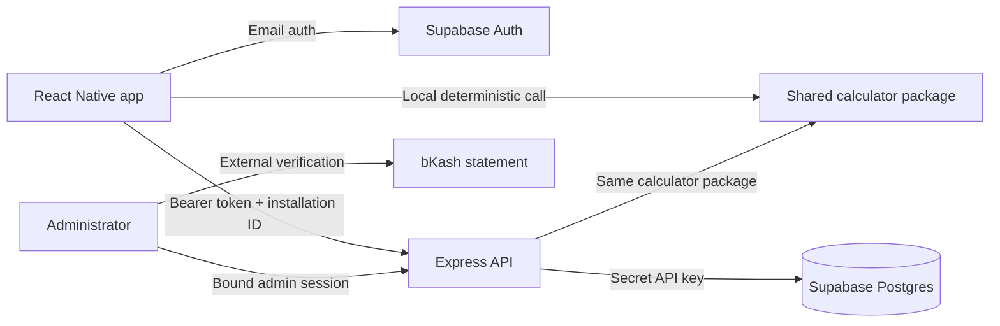

# Architecture



## Mobile boundary

The Expo app uses Supabase directly only for authentication. It calculates the free estimate locally with the shared package. Product data goes through Express so payment review, device binding, premium content, and project ownership have one policy boundary.

The app can boot without backend variables. In that mode, free calculation and the three bundled guide sections remain available; login and premium features explain that configuration is missing.

## API boundary

Express validates a Supabase user token with the publishable key. It then uses a server-only Supabase secret key for database operations. Because that key bypasses RLS, every store call receives the verified user ID from middleware and applies explicit ownership filters. RLS and revoked client grants remain defense in depth.

Middleware order for premium endpoints is:

```text
rate limit -> verify token -> no-store -> verify device -> verify entitlement -> handler
```

Admin endpoints add an `admin_users` lookup after device verification.

## Database boundary

| Table              | Purpose                            | Client exposure |
| ------------------ | ---------------------------------- | --------------- |
| `profiles`         | Auth-linked email profile          | API secret only |
| `admin_users`      | Trusted administrator allow list   | API secret only |
| `device_bindings`  | HMAC installation binding          | API secret only |
| `payment_requests` | Pending and reviewed manual claims | API secret only |
| `entitlements`     | Lifetime premium truth             | API secret only |
| `projects`         | Premium saved calculations         | API secret only |
| `guide_sections`   | Free and premium guide content     | API secret only |

Every table has RLS enabled. Policies are present for future user-scoped access, but current grants intentionally restrict product tables to the server role.

## Device binding

The mobile app generates a random UUID and stores it in OS secure storage. The API computes `HMAC-SHA256(installationId, serverPepper)` and stores only the digest. Partial and primary unique indexes enforce one active digest per user and one active user per digest.

This does not prove physical-device identity. A compromised client can copy identifiers. The control is intended to deter casual credential sharing while preserving a support-led reset process.

## Payment approval

Payment submission creates only a pending row. The public approval function is execution-revoked from public, anon, and authenticated roles and granted only to the server role. It updates the pending request and creates the entitlement inside one transaction.

## Rule versioning

`homexbd-workbook-v1` is stored with each project. New rates or a detailed bill-of-quantities model should introduce a new version and migration plan so old projects remain reproducible.
